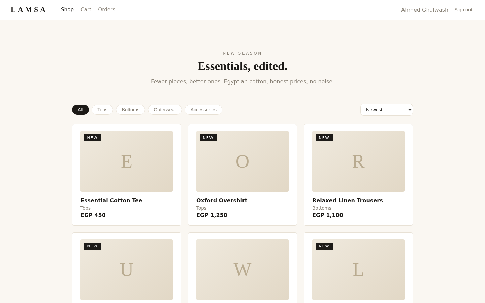
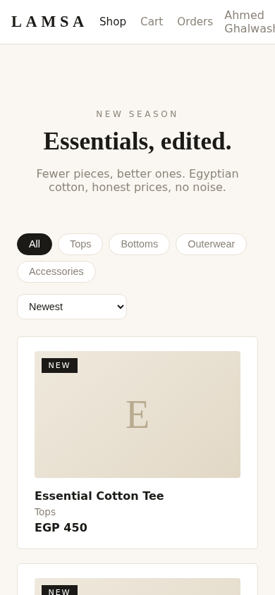
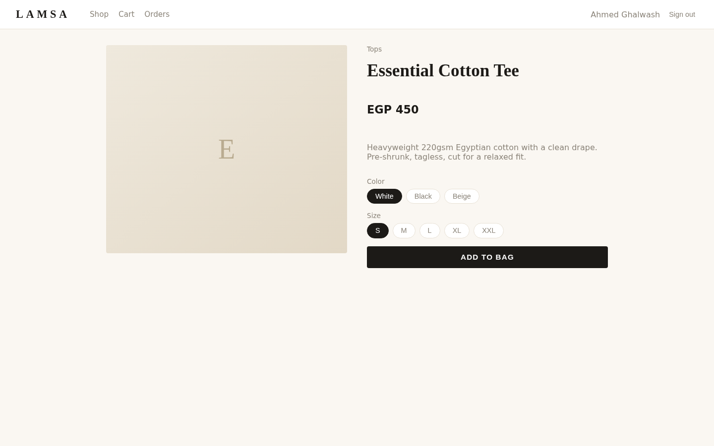

# Lamsa - Fashion E-Commerce

A minimal, editorial fashion shopping experience built around modern essentials.

Full-stack concept application: a **React 18** single-page client, a **PHP 8 REST API**
(framework-free, PDO with prepared statements) and a **MySQL** database.

## Features

- Catalog with category filter, search and price/newest sorting
- Server-side cart: variants are validated against the product, quantities capped
- Transactional checkout that recomputes totals from the products table
- Guarded stock decrement (UPDATE ... WHERE stock >= q) so items cannot be oversold
- Order history with snapshotted names and prices

## Tech stack

| Layer | Tech |
| --- | --- |
| Front end | React 18, Vite, React Router |
| Back end | PHP 8.1+, PDO (native prepared statements), PHP sessions |
| Database | MySQL 8 (InnoDB, foreign keys, transactions) |

## Screenshots

| Screen | Desktop | Mobile |
| --- | --- | --- |
| Storefront with filters |  |  |
| Product detail with size and color |  |  |
| Cart and checkout |  |  |
| Order history |  |  |

## Source code

The full source code for this project - the React client, the PHP REST API, and the
database schema with seed data - is kept in a **private repository**.

It is available on request: reach out through my
[GitHub profile](https://github.com/ahmed-ghalwash) and I will be happy to share it.
